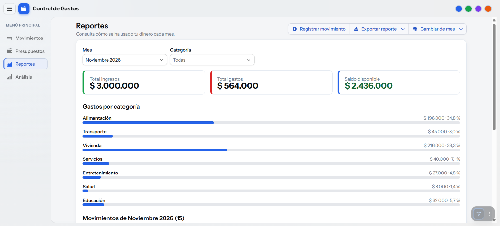
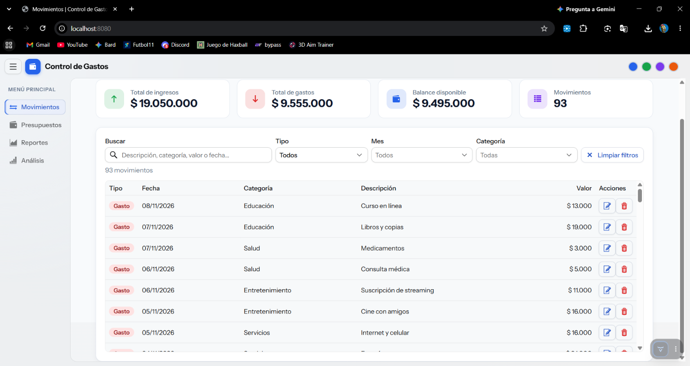
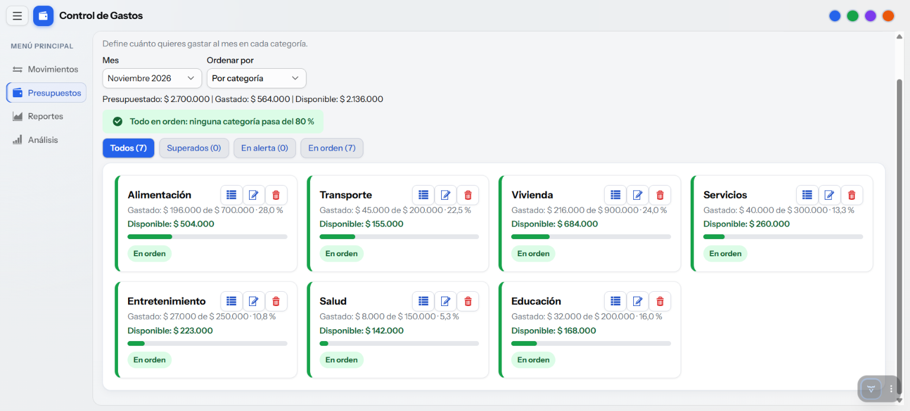
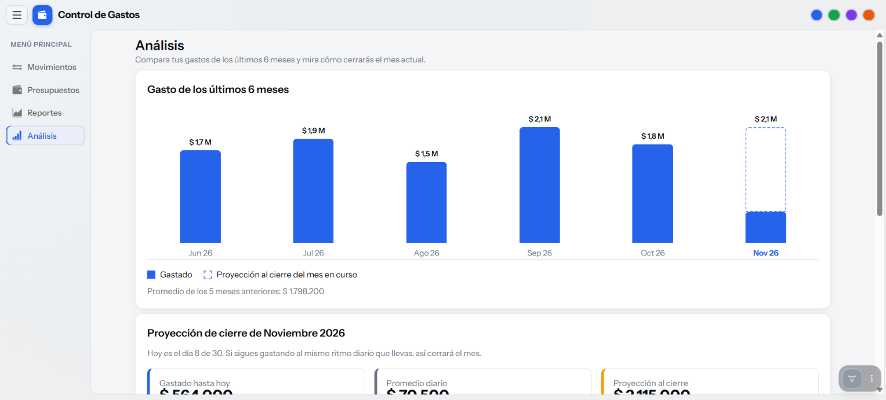

# Control de Gastos Personales

Aplicación web para administrar ingresos y gastos, controlar presupuestos mensuales por categoría y consultar reportes sobre el uso del dinero.

- **Autor:** Joelvis Segovia
- **Materia:** Lógica de Programación / Aplicaciones Web
- **Fecha:** Noviembre de 2026
- **Repositorio:** https://github.com/elvis37473/control-gastos

## Descripción

Una persona puede registrar sus ingresos y gastos, definir presupuestos mensuales por categoría y consultar alertas cuando el gasto supera ciertos límites. Los datos se guardan en archivos de texto (`.txt`), sin base de datos.

## Funcionalidades

- **Movimientos:** crear, consultar, modificar y eliminar ingresos y gastos (tipo, valor, fecha, categoría y descripción), con búsqueda por descripción, categoría, valor o fecha y filtros por tipo, mes y categoría.
- **Presupuestos:** presupuesto mensual por categoría, gasto acumulado, porcentaje usado y estados en orden (hasta el 80 %), en alerta (más del 80 %) y superado (más del 100 %).
- **Reportes:** ingresos, gastos, saldo y gastos agrupados por categoría, con filtros por mes y categoría, descarga del reporte como `.txt` y una copia en `exportaciones/`.
- **Análisis (bonificación):** gráfico de barras con los gastos de los últimos seis meses y proyección del gasto al cierre del mes actual, con avisos según los presupuestos.
- Formularios con validación, notificaciones, confirmación antes de eliminar y ayudas emergentes (`Tooltip`).
- Interfaz con menú lateral adaptable y tarjetas que reorganizan su contenido según el espacio disponible.

## Tecnologías

- Java 21
- Spring Boot 4.1.2
- Vaadin 25.3.5 (Flow)
- Maven
- Archivos de texto `.txt` para guardar los datos

## Componentes de Vaadin investigados

| Componente | Dónde se usa | Para qué |
|---|---|---|
| `ProgressBar` | Presupuestos, reportes y análisis | Representa el porcentaje del presupuesto usado. |
| `MenuBar` | Reportes | Agrupa acciones para registrar movimientos, exportar y cambiar de mes. |
| `Tooltip` | Botones, barras y tarjetas | Muestra información adicional. |

## Requisitos previos

- Java 21 o superior
- Conexión a internet la primera vez para descargar Maven y las dependencias
- Se puede usar el Maven Wrapper incluido, sin instalar Maven por separado

## Cómo ejecutar

Clona el repositorio y entra en la carpeta del proyecto:

```powershell
git clone https://github.com/elvis37473/control-gastos.git
cd control-gastos
```

En Windows, inicia la aplicación con:

```powershell
.\mvnw.cmd spring-boot:run
```

En macOS o Linux, usa:

```bash
./mvnw spring-boot:run
```

Luego abre <http://localhost:8080>. La primera ejecución puede tardar mientras Maven descarga los componentes necesarios. Para detener la aplicación, pulsa `Ctrl+C` en la terminal. Si el puerto 8080 está ocupado, cambia `server.port` en `src/main/resources/application.properties`.

## Datos de ejemplo

Al iniciar, la aplicación crea `datos/movimientos.txt` y `datos/presupuestos.txt` solo si esos archivos no existen. Los ejemplos abarcan los últimos seis meses, incluido el mes actual. Los datos existentes se conservan al reiniciar.

Para volver a generar los datos de ejemplo, detén la aplicación, elimina la carpeta `datos/` y vuelve a iniciarla. `datos-ejemplo/` contiene archivos de referencia y la aplicación no los lee ni modifica.

Los archivos usan campos separados por `|`:

```text
movimientos.txt:   id|TIPO|valor|fecha|categoría|descripción
                   1|INGRESO|3000000.00|2026-11-01|Salario|Pago mensual

presupuestos.txt:  mes|categoría|valor
                   2026-11|Alimentación|700000.00
```

## Manual de uso

El menú lateral permite abrir las cuatro pantallas. Los botones de color de la barra superior cambian el color de acento de la aplicación.

### Movimientos



- Escribe en la búsqueda para localizar movimientos por descripción, categoría, valor o fecha.
- Usa los filtros de tipo, mes y categoría. El resumen muestra los resultados que coinciden con la búsqueda y los filtros.
- Usa **Nuevo movimiento** para registrar un ingreso o un gasto. Los campos se validan antes de guardar.
- Edita o elimina registros desde la tabla. La eliminación solicita confirmación.
- Al registrar un gasto, la aplicación puede mostrar una advertencia si el presupuesto de esa categoría supera los umbrales de alerta.

### Presupuestos



- Elige el mes para consultar el valor presupuestado, el gasto, el saldo disponible y el porcentaje usado por categoría.
- Las tarjetas y filtros distinguen las categorías en orden, en alerta (más del 80 %) y superadas (más del 100 %).
- Puedes ordenar y filtrar la lista, consultar los gastos de una categoría, crear presupuestos, editar su valor y eliminarlos con confirmación.
- No se permite repetir una categoría en el mismo mes. Si no hay presupuestos, puedes copiar los del mes anterior.

### Reportes



- Elige el mes y, opcionalmente, una categoría. Las tarjetas muestran ingresos, gastos y saldo; el detalle presenta los gastos agrupados por categoría.
- El menú permite registrar un movimiento, exportar el reporte y cambiar de mes.
- El reporte se descarga como `.txt` y se intenta guardar una copia en `exportaciones/`.

### Análisis (bonificación)



La pantalla compara los gastos de los últimos seis meses. La barra del mes actual distingue lo gastado hasta hoy de la proyección de cierre, calculada así:

```text
proyección = gasto del mes hasta hoy ÷ día del mes actual × cantidad de días del mes
```

El gráfico se construye con componentes `Div`, sin una librería externa de gráficos. La altura de las barras es proporcional al gasto; la parte punteada de la barra del mes actual representa la diferencia entre lo gastado y la proyección.

La pantalla también compara la proyección de cada categoría con su presupuesto mensual: muestra un aviso de superación si pasa del 100 % y uno de alerta si pasa del 80 %. Para ver estos avisos, debe haber presupuestos cargados para el mes actual.

Para probar la bonificación:

1. Abre **Análisis** desde el menú lateral y revisa las seis barras y la proyección del mes.
2. Comprueba los avisos de categorías, si hay presupuestos para el mes actual.
3. En **Movimientos**, registra un gasto en una categoría presupuestada.
4. Vuelve a **Análisis** para ver el efecto del gasto en la barra y en la proyección.

## Pruebas

Ejecuta la suite automatizada con Maven Wrapper:

```powershell
.\mvnw.cmd clean test
```

En macOS o Linux:

```bash
./mvnw clean test
```

Las pruebas existentes cubren el arranque de la aplicación, modelos, utilidades, persistencia y generación de datos.

## Estructura del proyecto

```text
control-gastos/
├── pom.xml
├── mvnw, mvnw.cmd
├── datos/                  (se crea al ejecutar; no se sube a GitHub)
├── datos-ejemplo/          (archivos de referencia)
├── exportaciones/          (copias de reportes exportados)
├── image.png               (captura de Movimientos)
├── image-1.png             (captura de Presupuestos)
├── image-2.png             (captura de Reportes)
├── image-3.png             (captura de Análisis)
└── src/
    ├── main/java/com/proyecto/gastos/com/proyecto/
    │   ├── Application.java
    │   ├── MainLayout.java
    │   ├── MovimientosView.java
    │   ├── PresupuestosView.java
    │   ├── ReportesView.java
    │   ├── AnalisisView.java
    │   ├── archivos/GestorArchivos.java
    │   ├── modelo/Movimiento.java
    │   ├── modelo/Presupuesto.java
    │   └── vistas/
    │       ├── Tarjeta.java
    │       └── Utilidades.java
    └── test/java/com/proyecto/gastos/com/proyecto/
        ├── ApplicationTests.java
        ├── archivos/GestorArchivosTest.java
        ├── modelo/ModelosTest.java
        └── vistas/UtilidadesTest.java
```

## Manejo de errores y validaciones

- Los formularios validan los campos antes de guardar y muestran los errores en la interfaz.
- Los modelos vuelven a validar los datos antes de escribirlos.
- Las líneas dañadas de los archivos `.txt` se informan en la consola y se omiten al cargar los registros.
- Los errores al cargar o guardar se notifican en la interfaz cuando ocurren en una pantalla.

## Limitaciones

- No hay usuarios ni inicio de sesión; la aplicación está pensada para uso individual.
- Los datos se almacenan en archivos de texto, adecuados para un proyecto pequeño.
- La aplicación se ejecuta mediante la configuración de desarrollo de Spring Boot.
